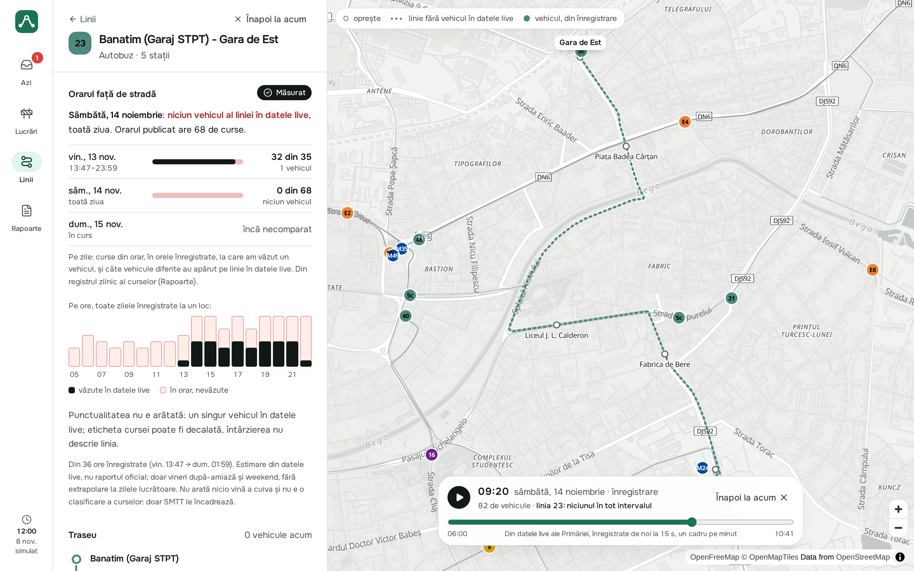
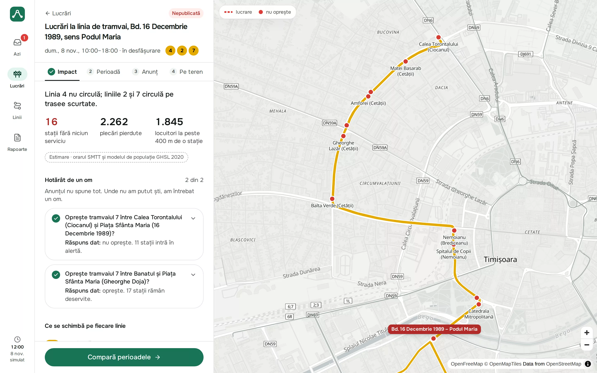
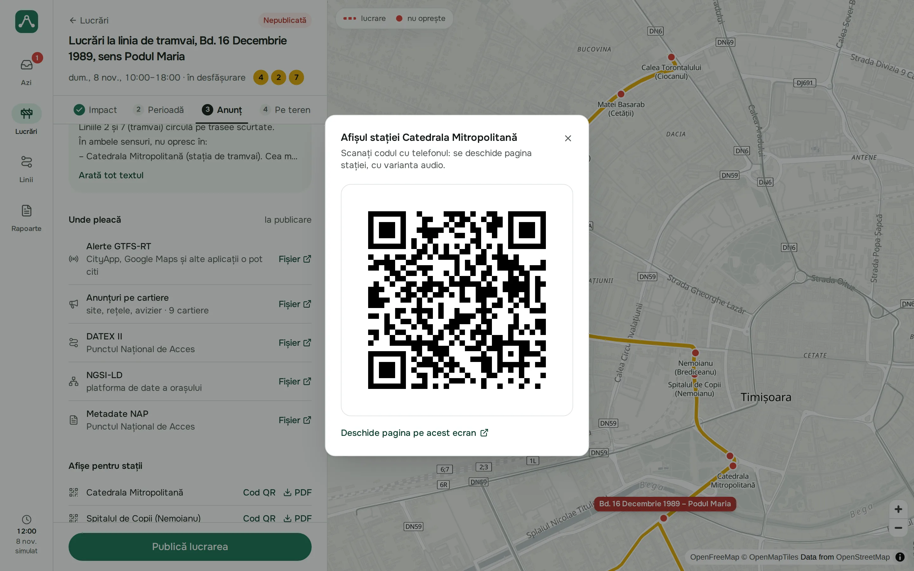
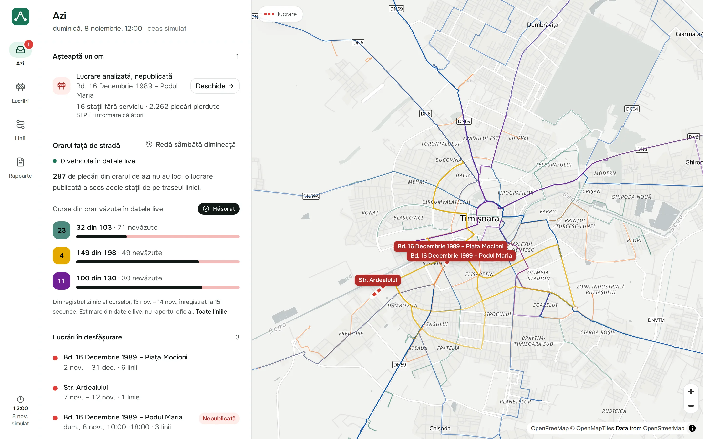

# Rețeaua Vie

Biroul de mobilitate al Primăriei Timișoara și al STPT pentru lucrările care închid o stradă pe unde trece transportul public: de la plan la raport. UniHack 8, Timișoara, 13–15 noiembrie 2026, categoria The Bloom: Green Mobility; înscris și la premiul NetRom „Glue It Together”. Echipa: Albert, Erol.
*The mobility back office of Timișoara City Hall and STPT for works that close a street with public transport on it, from plan to report. Each section is in Romanian first, then English.*

Demo: <https://unihack.alberyt.xyz> (ceas simulat / simulated clock: 8 nov 2026, 12:00) · API: [`/api/docs`](https://unihack.alberyt.xyz/api/docs), schema [`/api/openapi.json`](https://unihack.alberyt.xyz/api/openapi.json)

### Demo în 3 minute / 3-minute demo

- **Demo ghidat**, pitch-ul pe ecranele reale / *guided demo, the pitch on the real screens*: <https://unihack.alberyt.xyz/app/demo>
- **Începutul / the opener**: <https://unihack.alberyt.xyz/app/linii/R_AB_23?redare=09:20>, sâmbătă 14 nov la 9:20 din înregistrarea noastră: linia 23, 0 din 68 de curse din orar văzute în datele live / *Saturday 9:20 from our recording: line 23, 0 of 68 scheduled trips seen in the live data.*
- **Calea / the click path**: Linii › 23 (redare) → Azi → lucrarea Bd. 16 Decembrie: Impact (16 / 2.262 / 1.845) → Perioadă (500 în loc de 2.262) → Anunț → Publică → Cod QR → Lucrări › Piața Mocioni › Pe teren → Rapoarte.
- **Video de rezervă / backup video** (2:55, înregistrat pe site-ul public la 15 nov, 02:20, fără clicul pe „Publică” / *recorded on the public site, without the Publish click*): [`docs/media/walkthrough.mp4`](docs/media/walkthrough.mp4) · filmul de pe pagina principală / *landing film* (48 s): [`docs/media/film.mp4`](docs/media/film.mp4)
- **După o rulare / after a run**: publicarea se face o singură dată; resetarea scoate lucrările adăugate și readuce lucrarea demo la început / *publishing is one-shot; the reset removes added works and puts the demo work back at the start*: `cd backend && DATA_DIR=<data> uv run python -m app.demo_reset`

| Linia 23, redare / replay | Impactul unei lucrări / closure impact | Anunț și cod QR / notice and QR |
|---|---|---|
|  |  |  |



## 1. Ce este / What it is

Orarul e rețeaua de pe hârtie. Rețeaua Vie e rețeaua de pe stradă: vede unde diferă cele două, ajută Primăria să decidă și anunță oamenii prin CityApp. O folosesc biroul de mobilitate al Primăriei, STPT (dispecerat, informarea călătorilor) și SMTT; cetățenii nu o deschid, ei văd rezultatul în CityApp, Google și pe afișul din stație. Are patru locuri: **Azi** (ce așteaptă un om; orarul față de stradă: cursele din orar care nu apar în datele live ale Primăriei), **Lucrări** (o lucrare, în patru pași: **Impact**, adică ce linii și stații pierd serviciul, câte plecări, câți locuitori; **Perioadă**, fereastra de timp care strică cel mai puțin; **Anunț**, un text care numește fiecare stație, publicat o dată pentru toate canalele; **Pe teren**, ce au făcut de fapt vehiculele, din înregistrare), **Linii** (cursele din orar văzute în datele live, linie cu linie, cu stațiile în ordine) și **Rapoarte** (ce acoperă exporturile față de obligațiile UE, registrul zilnic al curselor pentru SMTT, istoric, indicatori, fișiere). Înregistrarea se poate și reda: `/app/linii/R_AB_23?redare=09:20` arată sâmbătă dimineața pe hartă, cu fiecare vehicul văzut și cu linia 23 fără niciunul (`GET /api/live/replay`, cadre din înregistrare, niciodată interpolate). În Lucrări, „Lucrare nouă, din anunț” citește un anunț STPT lipit și calculează impactul. Prima versiune a interfeței, în șase pași, rămâne la `/step/0` … `/step/5`. La publicare produce fișierele standard: alerte GTFS-RT ServiceAlerts, DATEX II, NGSI-LD, afișul A4 pentru stație cu cod QR și versiune audio, anunțurile pe cartiere și metadatele pentru Punctul Național de Acces (NAP). Completează CityApp, nu îl concurează: nu e o aplicație pentru călători (fără cont, fără abonament), ci produce fișierele pe care CityApp și Google le pot afișa. În Azi și în Linii arată și liniile din orar care n-au niciun vehicul în datele live ale Primăriei, înregistrate de noi (sâmbătă 14 nov, linia 23: 68 de curse în orar, niciun vehicul toată ziua); o astfel de linie ajunge în CityApp doar după ce un om o confirmă.

*The timetable is the network on paper. Rețeaua Vie is the network on the street: it sees where the two differ, helps City Hall decide and tells people through CityApp. Its users are City Hall's mobility office, STPT (dispatch, passenger information) and SMTT; citizens never open it, they see the result in CityApp, Google and on the stop poster. It has four places: **Today** (what waits for a person; the timetable against the street: scheduled trips that do not appear in City Hall's live data), **Works** (one closure in four tabs: **Impact**, i.e. which lines and stops lose service, how many departures, how many residents; **Period**, the time window that does the least harm; **Notice**, a text that names every stop, published once for every channel; **On the ground**, what vehicles actually did, from the recording), **Lines** (scheduled trips seen in the live data, line by line, stops in order) and **Reports** (what our exports cover against EU obligations, the daily trip registry for SMTT, history, indicators, files). The recording can also be replayed: `/app/linii/R_AB_23?redare=09:20` shows Saturday morning on the map, every vehicle seen and line 23 with none (`GET /api/live/replay`, frames from the recording, never interpolated). In Works, "new works, from a notice" reads a pasted STPT notice and computes the impact. The first six-step interface stays at `/step/0` … `/step/5`. Publishing produces standard files: GTFS-RT ServiceAlerts, DATEX II, NGSI-LD, an A4 stop poster with a QR code and an audio version, neighbourhood notices and metadata for the National Access Point (NAP). It complements CityApp rather than competing with it: it is not a rider app (no account, no subscription); it produces the files CityApp and Google can show. Today and Lines also list the lines that have scheduled trips but no vehicle in the City Hall's live data as we record it (Saturday 14 Nov, line 23: 68 scheduled trips, no vehicle all day); such a line reaches CityApp only after a person confirms it.*

## 2. Pornire / Run it

Testat pe Ubuntu 24.04. Trebuie: `uv` (Python 3.12), Node cu `pnpm`, Java 21 (R5 și validatorul GTFS-RT), bibliotecile WeasyPrint (Pango, HarfBuzz), `tmux`; pentru `make data` și `osmium-tool` și Docker. Lista exactă: [`backend/scripts/data/README.md`](backend/scripts/data/README.md).
*Tested on Ubuntu 24.04. Needs `uv` (Python 3.12), Node with `pnpm`, Java 21 (R5 and the GTFS-RT validator), the WeasyPrint libraries, `tmux`; `make data` also needs `osmium-tool` and Docker.*

```sh
make setup        # uv sync + pnpm install; checks Java 21 and WeasyPrint
make data         # SMTT GTFS, city endpoints, STPT notices, sesizări + OSM, GHSL 2020, GTFS-RT validator -> $DATA_DIR, provenance/sources.json
make data-city    # only the city sources (no osmium / Java)
make record       # tmux rv-record: live vehicles every 15 s; GTFS, STPT notices, sesizări every hour
make precompute   # caches + the 3 prepared closures (idempotent)
make dev          # API :3000 (reload) + frontend :3010, in tmux
make test         # backend tests (pytest)
make eval         # M1 on 5 real STPT notices -> eval/results/latest.json
python3 eval/readme_numbers.py   # copy the numbers of latest.json into section 7
make up           # Docker: api on :3000 + pre-compute worker (make down stops it)
infra/warm.sh     # call every demo endpoint once after a start (first calls build indexes)
```

`make demo` construiește frontendul și servește totul pe un singur port. / *`make demo` builds the frontend and serves everything on one port.*

| Variabilă / Variable | Implicit / Default | Rol / Role |
|---|---|---|
| `DATA_DIR` | `/srv/unihack/app/data` | cache-ul de date și starea (`state/`, `cache/`) / data cache and state |
| `ENV_FILE` | `/srv/unihack/app/.env` | fișier opțional `KEY=VALUE` cu chei; lipsa lui e în regulă / optional key file |
| `LIVE_DIR` | `$DATA_DIR/live` | înregistrările (GTFS, vehicule, sesizări, anunțuri STPT) / recordings |
| `DEMO_NOW` | `2026-11-08T12:00:00+02:00` | ceasul aplicației; `real` = ora reală / app clock; `real` = real time |
| `DATA_FREEZE` | gol / empty | `1`: `make data` nu descarcă nimic / no downloads |
| `PUBLIC_BASE_URL` | `https://unihack.alberyt.xyz` | adresa din QR, alerte și metadate / base URL in QR, alerts, metadata |
| `ELEVENLABS_API_KEY`, `ELEVENLABS_VOICE_ID` | gol / empty | opțional: vocea MP3 / optional MP3 voice |
| `R5_MAX_MEMORY` | `8G` | memoria R5 (timpi de acces) / R5 memory |
| `FRONTEND_DIST` | `frontend/dist` | frontendul construit, servit la `/` / built frontend |
| `API_PORT`, `WEB_PORT`, `RV_BIND`, `RV_PORT` | `3000`, `3010`, `0.0.0.0`, `3000` | porturi (Makefile, compose) / ports |

**Fără nicio cheie plătită.** Nucleul (citirea anunțului, analiza, deciziile, toate fișierele publicate, afișul) nu folosește LLM și nu cere nicio cheie: parserul de anunțuri e determinist. Singura cheie opțională e ElevenLabs, pentru MP3-urile a două lucrări pregătite, cu un plafon în cod de 8.000 de caractere pe lună (`m1_disruption/audio.py`). Fără ea, pagina QR citește alerta cu Web Speech din browser (ro-RO).
*No paid key. The core (notice reading, analysis, decisions, every published file, the poster) uses no LLM and needs no key: the notice parser is deterministic. The only optional key is ElevenLabs, for the MP3s of two prepared closures, capped in code at 8,000 characters a month. Without it the QR page reads the alert with the browser's Web Speech (ro-RO).*

**Datele nu sunt în git.** `make data` descarcă GTFS-ul SMTT (și 4.29, 4.30), copiile endpointurilor Primăriei, anunțurile STPT, sesizările (fără text), OSM, GHSL și validatorul (`backend/scripts/data/fetch_city.py`, `fetch_all.sh`); `make record` înregistrează vehiculele live (`record_vehicles.py`). Dacă o sursă cade, rămâne ultimul fișier bun, cu nota „memorat, sursa indisponibilă”. Fișierele ajung în `$LIVE_DIR/gtfs/*.zip`, `$DATA_DIR/city-api-2026-11-13/` (`transit-network.json`, `zones.geojson`, `parking.json`, `nomenclator-strazi.json`), `$LIVE_DIR/stpt-posts/`, `$LIVE_DIR/vehicles/`, `$LIVE_DIR/sesizari/`, iar GTFS 4.29 și 4.30 în `$DATA_DIR/gtfs-history/`. Testele care au nevoie de date lipsă sunt sărite, cu motivul scris.
*The data is not in git. `make data` fetches the SMTT GTFS (and 4.29, 4.30), the copies of the City Hall endpoints, the STPT notices, the reports (without text), OSM, GHSL and the validator; `make record` records the live vehicles. If a source is down, the last good file stays, with the note „memorat, sursa indisponibilă”. The files land at the paths above. Tests that need missing data are skipped with the reason.*

## 3. Ce e real, ce e model, ce e simulat / Real, model, simulated

| Tip / Kind | Ce / What | Eticheta în API sau interfață / Label |
|---|---|---|
| Real | Orarul planificat SMTT, GTFS 4.31 (și 4.29, 4.30 pentru traseele de dinainte de devieri) / planned timetable | sursă, versiune, dată în `provenance` |
| Real | Rețeaua, cartierele, Timpark, nomenclatorul de străzi: copii ale endpointurilor Primăriei din 13 nov 2026 / city endpoint copies | `provenance` |
| Real | Anunțurile STPT (texte de pe stpt.ro) / STPT notices | numărul postării / post id |
| Real | Vehiculele live: înregistrarea noastră, la 15 s, a unui endpoint CityApp nedocumentat / our recording of an undocumented CityApp endpoint | „CityApp vehicule live, înregistrarea noastră” (*undocumented API*) |
| Real | Liniile fără vehicul: orarul în vigoare comparat cu înregistrarea vehiculelor; o linie e marcată când niciun vehicul al ei nu apare cât are curse în orar / lines with scheduled trips and no vehicle in the recording | „din datele live ale Primăriei, înregistrate de noi”; „fără vehicul în datele live”, niciodată „cursă neefectuată” |
| Real | Sesizările din jurul lucrării, doar numărate pe categorii / reports near the closure, counts only | `null` = „necunoscut” în afara zilelor înregistrate |
| Model | Populația: GHSL 2020, celule de 100 m / population grid | „model GHSL 2020, nu recensământ” |
| Model | Timpii de acces la spital, școală, gară (R5, pe jos + transport, mediana pe 10 min de plecare) / access times | „estimare”, `estimate: true` |
| Model | Plecările pierdute: orarul planificat, nu ce a circulat / departures lost from the planned timetable | textul metodei / method text |
| Model | Ocolirea: structura străzilor, nu volume de trafic / detour: street structure, not traffic | „risc de încetinire”, niciodată minute / never minutes (minutele de la „Pe teren” sunt măsurate din înregistrare, nu din acest model / the minutes under "On the ground" are measured from the recording, not from this model) |
| Model | Ordinea ferestrelor de timp (orar planificat, conflicte, locuitori) / window ranking | „estimare pe orarul planificat” |
| Model | Scenariile: curse adăugate la o frecvență mai mare / scenarios: added trips | „simulare” |
| Simulat | Ceasul demo, 8 nov 2026 12:00 (`DEMO_NOW`); pagina QR folosește ora reală cât timp aceasta e în fereastra lucrării / demo clock | „Simulare: ora este …” |
| Simulat | Banda de afișaj din stație / station-display strip | „simulare: integrarea cu afișajele STPT nu există” |
| Simulat | Istoricul lucrărilor dinaintea platformei / back-filled history | „reconstituit din anunț STPT, nu publicat prin platformă” |
| Simulat | E3 și Mocioni apar publicate la ora anunțului STPT: publicare refăcută de `make precompute` / re-enacted publish | „reconstituit: publicat în demo din anunțul STPT din …” (câmpul `reconstructed` în API) / labelled in the UI and the API |
| Simulat | Vocea MP3 / MP3 voice | „Voce generată automat (AI), ElevenLabs” |

**Nu e al nostru / Not ours:** datele de mai sus și secțiunea 4; motorul de rutare R5 (prin r5py); validatorul MobilityData; schemele DATEX II și modelele FIWARE; MapLibre și harta de fundal OpenFreeMap; fonturile Noto Sans și IBM Plex; WeasyPrint. / *the data above and in section 4, R5 via r5py, the MobilityData validator, the DATEX II schemas and FIWARE models, MapLibre and the OpenFreeMap basemap, the Noto Sans and IBM Plex fonts, WeasyPrint.*

## 4. Surse de date / Data sources

Fiecare răspuns de analiză (impact, ferestre, biciclete, parcări, ocolire, sesizări, indicatori) poartă `provenance[]`: sursă, URL, versiune, `fetchedAt`. Lista de mai jos e ce citește codul și ce ține cache-ul nostru (`$DATA_DIR/provenance/sources.json`).
*Every analysis response carries `provenance[]` (source, URL, version, `fetchedAt`). The table lists what the code reads and what our cache holds.*

| Sursă / Source | Ce citim / What we read | Licență / Licence | Cache-ul nostru / Our cache |
|---|---|---|---|
| [GTFS SMTT](https://smtt.ro) (copia noastră prin `cont.primariatm.ro`) | stații, linii, curse, ore / stops, lines, trips, times | nedeclarată în `feed_info.txt` / not stated | 4.31, valabil 5 nov – 31 dec 2026, luat 13 nov 2026 |
| [Mobility Database `mdb-2868`](https://files.mobilitydatabase.org/mdb-2868/) (oglinda GTFS SMTT) | traseele de dinainte de devieri / pre-diversion patterns | ca mai sus / as above | 4.29 (din 24 oct), 4.30 (din 2 nov), luate 13 nov 2026 |
| [Rețeaua de transport](https://cont.primariatm.ro/api/mobile/transit/network) | linii, stații, trasee, culori | regulile ghidului Primăriei pentru UniHack 8: doar GET, cache / City Hall guide rules | versiunea `4.31-4`, 13 nov 2026 |
| [Cartiere](https://cont.primariatm.ro/api/zones) | 40 de cartiere (GeoJSON) | idem | 13 nov 2026 |
| [Timpark](https://cont.primariatm.ro/api/mobile/parking) | zone, tronsoane, parcări, tarife | idem | 13 nov 2026 |
| [Nomenclatorul străzilor](https://servicii.primariatm.ro/api/nomenclator/strazi) | numele oficiale ale străzilor / official street names | idem | 13 nov 2026 |
| [Vehicule live](https://cont.primariatm.ro/api/mobile/transit/vehicles) (nedocumentat) | poziție, linie, stație, întârziere / position, line, stop, delay | idem | înregistrare la 15 s din 13 nov 2026 |
| [Sesizări](https://sesizari.primariatm.ro/api/sesizari) | doar număr pe categorii / counts per category | idem | înregistrare din 13 nov 2026 |
| [Anunțuri STPT](https://stpt.ro/wp-json/wp/v2/posts) (API WordPress) | textul anunțurilor / notice text | nedeclarată / not stated | postările salvate / saved posts |
| [OpenStreetMap](https://download.geofabrik.de/europe/romania.html) via Geofabrik | străzi, piste, rastele, parcări, spitale, școli, gări | ODbL 1.0, © OpenStreetMap contributors | `romania-261112`, date OSM până la 12 nov 2026 21:23 UTC |
| [GHSL GHS-POP R2023A](https://human-settlement.emergency.copernicus.eu/), epoca 2020, 100 m | populație pe celulă (model) / population per cell | CC BY 4.0, © UE; Schiavina et al. (2023), doi:10.2905/2FF68A52-5B5B-4A22-8F40-C41DA8332CFE | tile R5_C21, luat 13 nov 2026 |
| [MobilityData gtfs-realtime-validator](https://github.com/MobilityData/gtfs-realtime-validator) | validarea feedului / feed validation | Apache-2.0 | 1.0.0-SNAPSHOT, imagine fixată prin digest |
| [DATEX II 3.5 XSD](https://docs.datex2.eu/downloads/modelv35/) | validarea în teste / test validation | fără licență de redistribuire: nu e în git | `$DATA_DIR/datex/xsd-3.5/` |

## 5. Integrare / Integration

Toate ieșirile sunt listate, cu data ultimei actualizări, la `GET /api/exports`. / *All outputs are listed, with their update time, at `GET /api/exports`.*

| Ieșire / Output | Endpoint | Standard | Validare / Validation |
|---|---|---|---|
| Alerte pe stație, linie și sens | `GET /api/feed/alerts.pb` | GTFS Realtime 2.0 ServiceAlert, FULL_DATASET | validatorul MobilityData după fiecare publicare (`GET /api/closures/{id}/validation`); fără Java sau jar rulează o verificare internă, marcată așa |
| Aceleași alerte, JSON | `GET /api/feed/alerts.json` | GTFS-RT Alert, vedere JSON | teste |
| Alerte NGSI-LD | `GET /api/feed/alerts.ngsi.json` | NGSI-LD, FIWARE `Alert` + `GtfsStop` | atributele obligatorii din `tests/test_m7_ngsi.py` |
| Situații de trafic | `GET /api/feed/datex.xml` | DATEX II v3.5 `SituationPublication` | contra XSD-ului oficial 3.5 în `tests/test_m7_datex.py` |
| Anunțuri pe cartier | `GET /api/feed/notices.json`, `GET /api/closures/{id}/notices` | format propriu `ZoneNotice[]`, RO + EN | teste |
| Afiș A4 de stație | `GET /api/closures/{id}/poster.pdf?stopId=` | PDF, QR de 5 cm spre `/a/{closureId}?stop=` | teste |
| Alerta audio | `GET /api/closures/{id}/audio/{stopId}.mp3` | MP3; altfel Web Speech pe pagina QR | teste |
| Istoric, indicatori | `GET /api/history`, `GET /api/indicators` | JSON propriu (istoricul perturbărilor MMTIS, indicatori PMUD / TEN-T) | teste |
| Metadate NAP | `GET /api/exports/nap-metadata.json` | mobilityDCAT-AP 1.0 (JSON-LD) | teste |

**Endpointurile orașului pe care le citim:** doar GET și niciodată la cererea unui utilizator. Backendul citește copii locale și înregistrarea din `$LIVE_DIR`; id-urile de linie și stație din GTFS sunt aceleași cu cele din rețeaua Primăriei (`/api/mobile/transit/network`, verificat pe 4.31). **Cine le poate folosi:** CityApp poate citi `alerts.pb` sau `alerts.json` pentru alerta pe stație și `notices.json` pentru anunțul pe cartier. Google Maps și alte aplicații de rute citesc alerte GTFS-RT când cine publică GTFS-ul static adaugă `alerts.pb` ca feed în timp real. Afișajele din stații pot primi aceeași alertă standard; integrarea nu există azi. O platformă NGSI-LD (de exemplu Orion-LD) ia `alerts.ngsi.json` prin upsert, iar `nap-metadata.json` descrie toate fișierele pentru Punctul Național de Acces.
*City endpoints we read: GET only, never on a user's request: the backend reads local copies and the recording in `$LIVE_DIR`; GTFS line and stop ids are the same as in the City Hall network endpoint (checked on 4.31). Who can use the outputs: CityApp can read `alerts.pb` or `alerts.json` for the stop alert and `notices.json` for the neighbourhood notice. Google Maps and other trip planners read GTFS-RT alerts once whoever publishes the static GTFS adds `alerts.pb` as its realtime feed. Station displays could take the same standard alert; that integration does not exist today. An NGSI-LD platform (e.g. Orion-LD) takes `alerts.ngsi.json` by upsert, and `nap-metadata.json` describes every file for the National Access Point.*

## 5b. Lipirea surselor / Glue It Together

Opt surse care nu se cunosc între ele ajung la **aceeași analiză a unei lucrări** și ies ca fișiere standard. Nimic nu se cheamă la cererea utilizatorului: fiecare sursă e citită o dată și ținută în cache.
*Eight sources that do not know each other meet in **one analysis of a closure** and leave as standard files. Nothing is fetched on a user's request: each source is read once and cached.*

| Sursă / Source | Ce aduce / What it brings | Unde intră / Where it goes in |
|---|---|---|
| GTFS SMTT 4.31 | orarul: plecări, trasee, opriri | plecări pierdute, km nefăcuți, acoperire, coridoare |
| Rețeaua și cartierele Primăriei | linii, stații, 40 de cartiere | stațiile afectate, locuitorii pe cartier |
| `transit/vehicles` (**nedocumentat**: un singur cititor, la 15 s, din cache) | poziția și întârzierea vehiculelor | orarul observat, verificarea la stații, fiabilitatea pe linie |
| Anunțuri STPT | textul lucrării | parserul: ce stații și linii se suspendă |
| OpenStreetMap | rețeaua de drumuri, semafoare, străzi | ocolirea, străzile de cartier, mersul pe jos |
| GHSL 2020 (model) | locuitori pe celulă de 100 m | locuitori fără stație, acoperire slabă cu transport public |
| Sesizări | doar numărul pe categorii | bilanțul lucrării |
| Validatorul GTFS-RT, r5py, WeasyPrint | verificarea feedului, accesul pe rețea, afișul PDF | publicare și rapoarte |

**Un singur drum:** anunț → rânduri suspendate → plecări pierdute și locuitori → ocolire → fereastră → publicare. **Patru familii de ieșiri:** (1) *CityApp*: `alerts.pb`, `alerts.json`, `notices.json`; (2) *textul anunțului*: `GET /api/closures/{id}/notice` și afișul de stație; (3) *SMTT*: km nefăcuți, `GET /api/closures/{id}/km?format=csv`; (4) *aplicații de navigație*: `waze-cifs.json` și `avoid-streets.geojson` („pot citi”: nu știm ca vreo aplicație să le citească).
*One path: notice, suspended rows, lost departures and residents, detour, window, publish. Four output families: CityApp feeds; the notice text and stop poster; SMTT km and CSV; two files a navigation app could read (we do not know that any does).*

**Înghețat la 15 nov 2026, 09:30 (`tools/facts/freeze.py`), cu fereastra fiecărei cifre; înregistrarea continuă, deci ecranul arată mai mult / Frozen on 15 Nov 2026 at 09:30, with each figure's window; the recording continues, so the screen shows more:**

- Înregistrarea vehiculelor, **din 43 ore înregistrate (vin. 13:47 → dum. 08:59), până dum. 09:30**: 541.660 rapoarte de la 187 vehicule, din care orarul observat scoate 69.228 de opriri (`GET /api/observed/summary`).
- Aceeași înregistrare (din 44 ore, vin. 13:47 → dum. 09:34): **82,6 %** din 5.880 de curse cu indicator au vehicul marcat accesibil în fluxul Primăriei; stația nu e verificată (`GET /api/accessibility/lines`).
- GTFS 4.31, zi de lucru 2026-11-09 (orar planificat, nu observat), GHSL 2020: **71.598 din 366.817** de locuitori au acoperire slabă cu transport public, adică sub 2 plecări pe oră la 400 m (`GET /api/coverage/zones`); 64 de coridoare cu mai multe linii pe aceleași stații (`GET /api/corridors`).
- Din `eval/results/latest.json` (2026-11-14T13:42:48+02:00, commit `941f384`, GTFS 4.31): validatorul MobilityData **a trecut** pe feedul publicat, la 3 rulări; lucrarea demo `cl_20261108_16dec`, 2026-11-08 10:00–18:00: 2.262 de plecări pierdute și 1.845 de locuitori fără stație la 400 m (model, nu recensământ). Restul cifrelor de evaluare: secțiunea 7.
*Vehicle recording, from 43 recorded hours (Fri 13:47 → Sun 08:59), frozen Sun 09:30: 541,660 reports from 187 vehicles, from which the observed timetable derives 69,228 stop events. Same recording (44 h, to Sun 09:34): 82.6 % of 5,880 trips with a flag ran with a vehicle the City Hall feed marks step-free; the stop is not verified. GTFS 4.31, weekday 2026-11-09 (planned, not observed), GHSL 2020: 71,598 of 366,817 residents have weak public transport coverage (under 2 departures an hour within 400 m); 64 corridors. From `eval/results/latest.json` (generated 2026-11-14T13:42:48+02:00, commit 941f384): the MobilityData validator passed on the published feed in 3 runs; the demo closure shows 2,262 departures lost and 1,845 residents losing their stop. The rest of the evaluation: section 7.*

## 6. Lista de adoptare / Adoption checklist

Criteriile din ghidul Primăriei. ✔ doar unde codul o arată. / *City Hall guide criteria; ✔ only where the code shows it.*

| Criteriu / Criterion | | Ce arată codul / What the code shows |
|---|---|---|
| Proprietar numit / Named owner | ✘ | Nu încă: editorul din DATEX II și din metadatele NAP este „Rețeaua Vie (demo, UniHack 8)”, iar `PUBLIC_BASE_URL` arată spre serverul nostru. Un pilot trece aici departamentul care îl rulează.<br>*Not yet: the DATEX II and NAP publisher is the demo, and `PUBLIC_BASE_URL` points at our server. A pilot puts the running department there.* |
| Se potrivește canalelor existente / Fits existing channels | ✔ | Fișiere standard pentru CityApp, Google, NAP și afișe în stații; nicio aplicație, cont sau abonament pentru cetățeni.<br>*Standard files for CityApp, Google, the NAP and stop posters; no citizen app, account or subscription.* |
| Rulează fără noi / Runs without us | ✔ | ✔ MIT; ✔ nucleul nu cere nicio cheie plătită; ✔ `make up` (Docker); ✔ `make data` și `make record` aduc și înregistrează toate sursele (secțiunea 2). Endpointurile Primăriei nu au garanție de funcționare, iar cel cu vehicule live e nedocumentat: când cad, rămâne ultimul fișier bun.<br>*✔ MIT, no paid key for the core, Docker; `make data` and `make record` fetch and record every source. The City Hall endpoints have no uptime guarantee and the live vehicle one is undocumented: when they fail, the last good file stays.* |
| Română întâi / Romanian first | ✔ | Interfața în română (`<html lang="ro">`; aplicația în `frontend-v3/`, pagina de telefon din QR și prima consolă în `frontend/`, cu textele în `frontend/src/i18n`; `frontend-v2/` e un prototip abandonat, nici construit, nici servit), engleza unde ajută; alertele, afișul și anunțurile în RO, apoi EN. Textul NGSI-LD e doar în română.<br>*Romanian UI, English where it helps; alerts, poster and notices RO then EN. NGSI-LD text is Romanian only.* |
| Accesibilitate / Accessibility | parțial | În cod: `lang="ro"`, focus vizibil la tastatură, `prefers-reduced-motion`, etichete `aria`, versiunea audio a fiecărei alerte de stație, numele stației pe afiș în 48 pt. Am rulat axe 4.10 pe interfața v3 (15 nov: Azi, impactul lucrării-erou, pagina liniei 23): 0 încălcări grave sau critice; pe consola veche (14 nov): 0. Nu am rulat Lighthouse, un audit WCAG complet sau un test cu cititor de ecran. GTFS-ul SMTT nu are câmpuri de accesibilitate, deci nu afirmăm rute fără bariere.<br>*In code: the items above. We ran axe 4.10 on the v3 interface (15 Nov: Today, the hero works impact, the line 23 page): 0 serious or critical violations; on the old console (14 Nov): 0. We have not run Lighthouse, a full WCAG audit or a screen-reader test. The SMTT GTFS has no accessibility fields, so we claim no step-free routes.* |
| Privat implicit / Private by default | ✔ | Fără conturi, cookie-uri, `localStorage` sau trackere; fonturile sunt incluse; doar harta de fundal vine de la OpenFreeMap. Stocăm lucrările, deciziile, scenariile și publicările ca JSON în `$DATA_DIR/state/`, plus cache-uri în `$DATA_DIR/cache/`; nu există un termen de păstrare, nimic nu expiră automat. Din sesizări iese doar numărul pe categorii (`live/reports.py`), niciodată textul, pozele, numele sau punctul. Uvicorn scrie jurnalul de acces (IP, cale) în consolă.<br>*No accounts, cookies, `localStorage` or trackers; fonts are bundled; only the basemap comes from OpenFreeMap. We store closures, decisions, scenarios and publications as JSON in `state/`, plus caches; there is no retention period, nothing expires automatically. Only per-category counts leave the reports module. Uvicorn logs access (IP, path) to the console.* |
| Date oneste / Honest data | ✔ | `provenance[]` lângă cifre (sursă, versiune, dată); necunoscut = `null` / „necunoscut”, niciodată 0; modelele și simulările poartă eticheta din secțiunea 3; cifrele de mai jos sunt copiate de un script, nu tastate.<br>*`provenance[]` next to figures; unknown is `null`, never 0; models and simulations carry the labels in section 3; the numbers below are copied by a script.* |

## 7. Cifre măsurate / Measured numbers

<!-- numbers:start -->
<!-- generated by eval/readme_numbers.py from eval/results/latest.json; do not edit by hand -->
Toate cifrele de aici vin din `eval/results/latest.json`, scris de `make eval` la 2026-11-14T14:02:07+02:00 (commit `3c4452c`), pe GTFS SMTT 4.31 (valabil 2026-11-05 – 2026-12-31, sha256 `8905216072b3`), copiate de `eval/readme_numbers.py`. Detalii: [`eval/README.md`](eval/README.md).  
*Every figure here comes from `eval/results/latest.json`, written by `make eval` at the time and commit above, copied by `eval/readme_numbers.py`. Details: [`eval/README.md`](eval/README.md).*

**Citirea anunțurilor STPT / Reading STPT notices** (5 anunțuri reale / real notices; cheia de răspuns / answer key: etichete asistate de AI, verificare umană în curs / *AI-assisted from the notice text; human review pending*)

- **80 din 101** rânduri suspendate (stație, linie, sens) găsite sigur, **0** false (precizie 100,0%, recall 79,2%). Cu rândurile marcate „neclar”, pe care le decide funcționarul: 101 din 101, 0 false. Metoda: `eval/run.py` dă fiecare anunț parserului și analizei M1 și compară rândurile cu cheia de răspuns; rândurile pe care cheia le lasă nesigure nu se punctează.  
  *80 of 101 suspended (stop, line, direction) rows found as certain, 0 false (precision 100.0%, recall 79.2%). Counting the „neclar” (unsure) rows the clerk decides: 101 of 101, 0 false. Method: `eval/run.py` feeds each notice to the M1 parser and analysis and compares the rows with the answer key; rows the key leaves uncertain are not scored.*
- **38,5%** din rândurile găsite merg la „neclar”: platforma nu ghicește, întreabă funcționarul. Metoda: rânduri „neclar” / toate rândurile găsite, pe toate anunțurile.  
  *38.5% of the rows found are sent to „neclar”: the platform does not guess, it asks the clerk. Method: unsure rows / all rows found, over all notices.*
- **0,26 s** (mediana) de la anunțul lipit la alerta GTFS-RT publicată, maximum 1,12 s, pe 3 anunțuri; celelalte 2 anunțuri nu au niciun rând de publicat. Metoda: `eval/run.py` rulează API-ul în proces, cu ceasul la data anunțului: citește anunțul, analizează, confirmă tot ce propune platforma, publică și citește `/api/feed/alerts.pb`. Timpul în care un om decide nu e inclus. Fără nicio cheie LLM sau text-to-speech.  
  *0.26 s (median) from pasted notice to published GTFS-RT alert, maximum 1.12 s, over 3 notices; the other 2 notices have no row to publish. Method: `eval/run.py` drives the API in-process with the clock at the notice date: parse, analyze, confirm every proposed row, publish, read `/api/feed/alerts.pb`. The time a person takes to decide is not included. No LLM or text-to-speech key is used.*
- Validatorul MobilityData GTFS-RT **a trecut** pe feedul publicat, la 3 rulări (`gtfsRtValidatorPass`).  
  *The MobilityData GTFS-RT validator **passed** on the published feed, 3 runs.*
- **2 din 39** pe referința independentă (rândurile pe care SMTT le-a scos din propriul GTFS între versiuni, `eval/gold_gtfs_diff.py`, fără etichete de-ale noastre), 0 false.  
  *2 of 39 on the independent gold (rows SMTT removed from its own GTFS between versions, `eval/gold_gtfs_diff.py`, no labels of ours), 0 false.*
- De ce calea anunțului are 2 din 39: la 11062 găsește 2 din 7, stațiile E3 de pe strada Polonă, citite pe GTFS-ul în vigoare când începe schimbarea (4.30); celelalte 5 sunt stații pe care noul traseu nu le mai deservește și pe care anunțul nu le numește. La 11060 găsește 0 din 27: parserul citește listele de stații deservite pe GTFS-ul de azi, 4.31, unde traseul e deja deviat; cifra independentă onestă este cazul Mocioni pregătit pe GTFS-ul în vigoare înainte de lucrări (4.29), care găsește **27 din 27** de rânduri, 0 false. Cele 5 rânduri ale 11058 sunt liniile M11, M29 și M30, unde GTFS-ul scoate „Moldovei (Ghiroda)” și renumerotează „Girație Pod Bega”, ce anunțul 11058 nu menționează.  
  *Why the notice path scores 2 of 39: on 11062 it finds 2 of 7, the E3 stops on Polonă street, read on the GTFS in force when the change starts (4.30); the other 5 are stops the new route no longer serves, which the notice does not name. On 11060 it finds 0 of 27: the parser reads the served-stop lists on today's GTFS, 4.31, where the route is already diverted; the honest independent figure is the prepared Mocioni case, built on the GTFS in force before the works (4.29), which finds 27 of those 27 rows with 0 false positives. The 5 rows of 11058 are M11, M29 and M30, where the GTFS drops „Moldovei (Ghiroda)” and renumbers „Girație Pod Bega”, which notice 11058 never mentions.*

**Cifre de impact / Impact figures**

- **253** de plecări programate E3 pe zi lucrătoare în stațiile suspendate (anunț STPT 11065), la 11 id-uri de stație, ziua 2026-11-09, aceeași în fiecare zi lucrătoare a închiderii. Metoda: `eval/e3_departures.py` numără plecările din `stop_times` ale curselor E3 care circulă în ziua aceea (`calendar.txt` și `calendar_dates.txt`); ultima stație a unei curse nu e o plecare; orele de după 24:00 trec în ziua următoare.  
  *253 scheduled E3 departures per weekday at the stops suspended by STPT notice 11065, at 11 stop ids, 2026-11-09, the same on every weekday of the closure. Method: GTFS stop_times of trips of route R_AB_E3 whose service runs that day (calendar.txt weekday flags and date range, then calendar_dates.txt add/remove). Departures only: the last stop of a trip is not counted. Stops: the names the notice suspends, per direction, matched to E3's own pattern. Calendar day = local clock (Europe/Bucharest); times >= 24:00 roll to the next day.*
- Lucrarea demo `cl_20261108_16dec` (2026-11-08 10:00–18:00): **16** stații fără niciun mijloc de transport, **2.262** de plecări pierdute, **1.845** de locuitori fără stație la 400 m (model GHSL 2020, nu recensământ), 3 linii afectate. Metoda: Plecări pierdute: orarul GTFS al fiecărei linii și direcții, la fiecare stație afectată, în fereastra lucrării. Stație suspendată: nicio altă plecare a vreunei linii în fereastră, iar anunțul nu spune că o linie o deservește. Locuitori fără stație: celule GHSL 2020 de 100 m (model, nu recensământ) aflate la cel mult 400 m (linie dreaptă) de o stație suspendată și fără nicio stație deservită la 400 m. Stațiile neclare contează doar după o decizie. Deciziile sunt cele din cheia de răspuns (21 bifate, 29 debifate), aplicate pe o copie.  
  *Demo closure (2026-11-08 10:00–18:00): 16 stops with no service, 2,262 departures lost, 1,845 residents losing their stop within 400 m (a model, not a census), 3 lines affected. Method: Departures lost: the GTFS timetable of each line and direction at each affected stop inside the closure window. Suspended stop: no other departure of any line in the window, and the notice does not say a line serves it. Residents losing their stop: GHSL 2020 100 m cells (a model, not a census) within 400 m (straight line) of a suspended stop with no served stop within 400 m. Unsure stops count only after a decision. Decisions: gold label 11067: tick the unsure rows labelled suspended (line 7, certain), untick the unsure rows labelled uncertain (ring Banatul -> Piața Maria) (21 ticked, 29 unticked), applied to a copy.*
<!-- numbers:end -->

## 8. Cum l-am construit / How we built it

Doi oameni și agenți AI de programare (Claude Code și Codex), pe o singură mașină de dezvoltare. Agenții s-au coordonat printr-un spațiu de lucru comun și prin mesaje cu rezervări de fișiere (MCP Agent Mail); ei au scris codul și au făcut commit-urile. Oamenii au stabilit direcția, au verificat rezultatele și au testat demo-ul. Tot codul din acest repo a fost scris în timpul evenimentului (vineri 13 nov, 13:00 – duminică 15 nov, 13:00). Cheia de răspuns din `eval/labels/` e făcută cu ajutor AI și e marcată așa; produsul nu folosește un LLM la rulare.
*Two people and AI coding agents (Claude Code and Codex) on one development machine. The agents coordinated through a shared workspace and messages with file reservations (MCP Agent Mail); they wrote the code and made the commits. The humans set the direction, checked the results and tested the demo. Every line in this repo was written during the event (Fri 13 Nov 13:00 – Sun 15 Nov 13:00). The answer key in `eval/labels/` is AI-assisted and marked so; the product uses no LLM at runtime.*

## 9. Licență / Licence

MIT, vezi [`LICENSE`](LICENSE). Datele își păstrează licențele (OSM: ODbL 1.0; GHSL: CC BY 4.0); fontul Noto Sans din `backend/fonts/` e sub OFL.
*MIT, see [`LICENSE`](LICENSE). Data keeps its own licences (OSM: ODbL 1.0; GHSL: CC BY 4.0); the Noto Sans font in `backend/fonts/` is under the OFL.*
